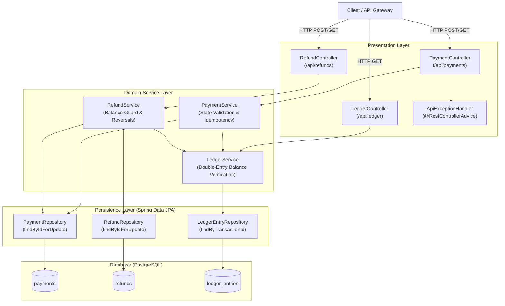
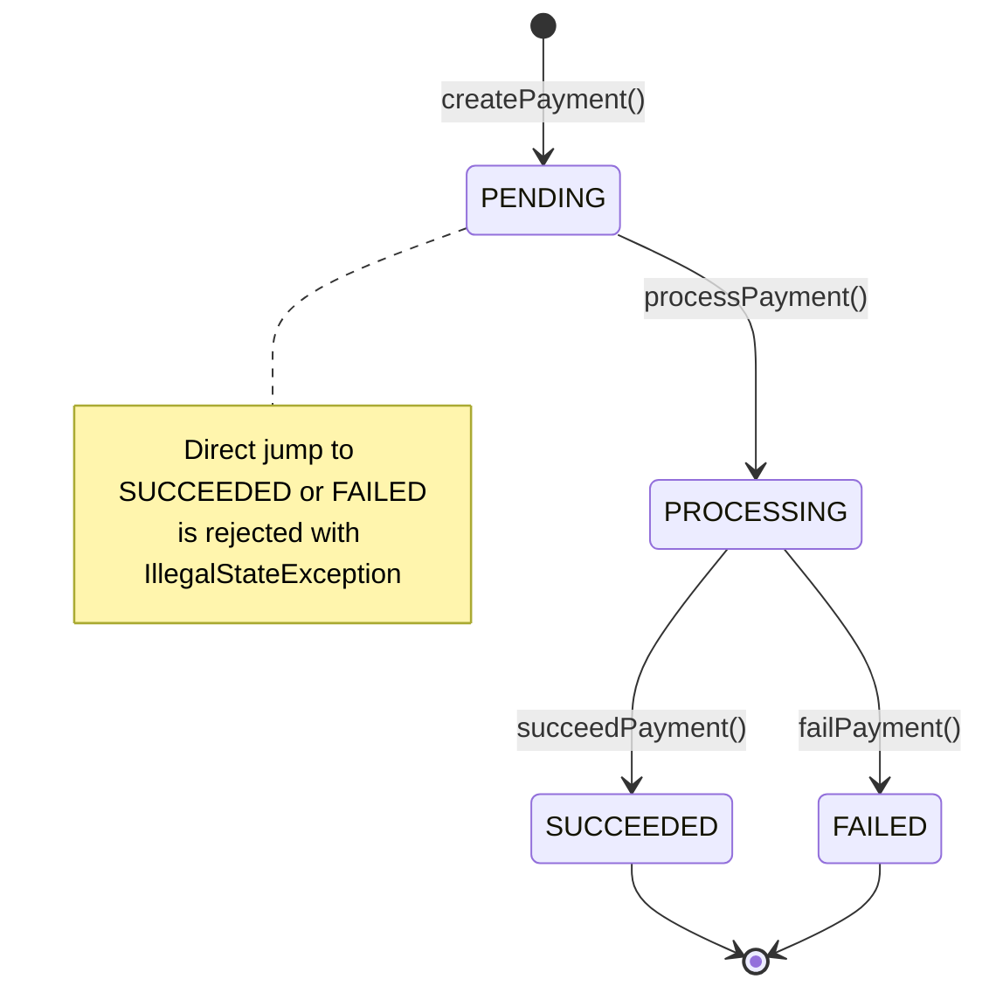
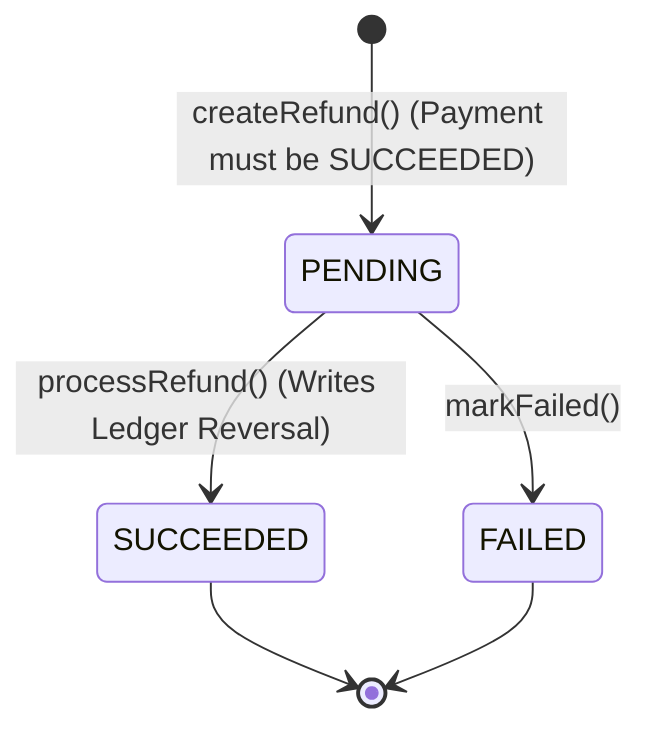
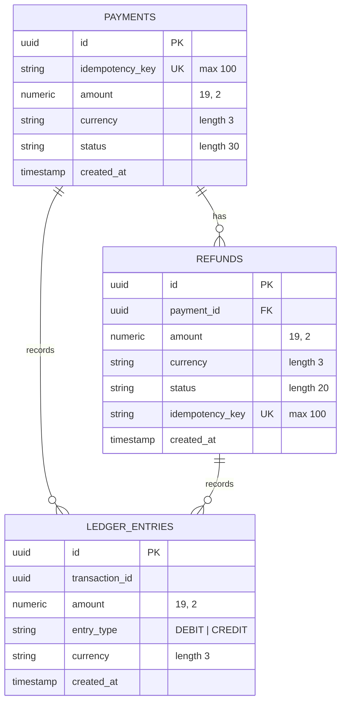

# PayFlow &mdash; Robust Financial Payment & Ledger Platform

[](https://openjdk.org/)
[](https://spring.io/projects/spring-boot)
[](https://www.postgresql.org/)
[](https://hibernate.org/)
[](LICENSE)

**PayFlow** is an enterprise-grade payment processing engine engineered with financial rigor. It ensures zero double-spending through strict idempotency guarantees, maintains mathematical integrity with double-entry ledger accounting, and eliminates race conditions during refunds using pessimistic database locking.

---

## Table of Contents

- [Core Principles](#core-principles)
- [Key Features](#key-features)
- [System Architecture](#system-architecture)
- [State Machine Workflows](#state-machine-workflows)
- [Double-Entry Accounting Model](#double-entry-accounting-model)
- [Concurrency & Locking Strategy](#concurrency--locking-strategy)
- [Database Schema](#database-schema)
- [REST API Reference](#rest-api-reference)
  - [Payment Endpoints](#1-payment-endpoints)
  - [Refund Endpoints](#2-refund-endpoints)
  - [Ledger Endpoints](#3-ledger-endpoints)
  - [Observability & Health](#4-observability--health)
- [Error Handling & Conflict Resolution](#error-handling--conflict-resolution)
- [Project Structure](#project-structure)
- [Getting Started](#getting-started)
  - [Prerequisites](#prerequisites)
  - [Database Setup](#database-setup)
  - [Configuration](#configuration)
  - [Build and Run](#build-and-run)
- [Testing & Quality Assurance](#testing--quality-assurance)
- [Roadmap & Enhancements](#roadmap--enhancements)

---

## Core Principles

In financial and transactional systems, correctness and consistency take precedence over naive eventual consistency:

1. **Idempotency Guarantee**: Network failures, retries, and client timeouts never cause duplicate charges or duplicate refunds.
2. **Double-Entry Bookkeeping**: Money cannot appear or vanish arbitrarily. Every financial movement consists of balanced DEBIT and CREDIT ledger entries ($\sum \text{Debits} = \sum \text{Credits}$).
3. **Explicit State Transitions**: Entity statuses follow strict monotonic workflows with guard conditions preventing invalid state leaps (e.g., cannot succeed a pending payment directly).
4. **Pessimistic Locking**: Concurrent refund requests against the same payment are synchronized via database row locks (`SELECT ... FOR UPDATE`), preventing race conditions and over-refunding.

---

## Key Features

- **Payment Lifecycle Engine**: Explicit states (`PENDING`, `PROCESSING`, `SUCCEEDED`, `FAILED`) with protected transition rules.
- **Header-Driven Idempotency**: `Idempotency-Key` verification on payment and refund creation with payload mismatch detection.
- **Double-Entry General Ledger**: Immutable transaction entries recorded at creation and refund reversal phases.
- **Multi-Partial Refund Engine**: Support for arbitrary partial refunds up to the exact remaining unrefunded balance.
- **Pessimistic Concurrency Control**: Hibernate `@Lock(LockModeType.PESSIMISTIC_WRITE)` for balance verification and refund execution.
- **Centralized REST Error Handling**: Consistent JSON problem responses (`400 Bad Request`, `404 Not Found`, `409 Conflict`).
- **Production Observability**: Built-in Spring Boot Actuator health checks and metrics.

---

## System Architecture



---

## State Machine Workflows

### Payment Lifecycle

Payments follow a strict forward-only progression. State transitions outside the defined paths are rejected with `409 Conflict`.



| Current State | Target State | Allowed? | Trigger Action |
| :--- | :--- | :---: | :--- |
| `[Initial]` | `PENDING` | Yes | `POST /api/payments` |
| `PENDING` | `PROCESSING` | Yes | `POST /api/payments/{id}/process` |
| `PENDING` | `SUCCEEDED` | **No** | Blocked (Requires `PROCESSING` first) |
| `PENDING` | `FAILED` | **No** | Blocked (Requires `PROCESSING` first) |
| `PROCESSING` | `SUCCEEDED` | Yes | `POST /api/payments/{id}/succeed` |
| `PROCESSING` | `FAILED` | Yes | `POST /api/payments/{id}/fail` |
| `SUCCEEDED` | `PROCESSING` | **No** | Blocked (Terminal state) |
| `FAILED` | `PROCESSING` | **No** | Blocked (Terminal state) |

### Refund Lifecycle



---

## Double-Entry Accounting Model

Every financial transaction records both sides of the movement. Ledger balances must resolve to zero:

$$\sum \text{Amount}_{\text{DEBIT}} - \sum \text{Amount}_{\text{CREDIT}} = 0$$

### 1. Payment Initialization

When a payment of `INR 499.00` is created, two balanced entries are recorded under the payment ID:

| Transaction ID | Entry Type | Amount | Currency |
| :--- | :--- | :--- | :--- |
| `payment.id` | **`DEBIT`** | `499.00` | `INR` |
| `payment.id` | **`CREDIT`** | `499.00` | `INR` |

### 2. Refund Processing (Reversal)

When a refund of `INR 200.00` is processed, reversal entries are generated under the refund ID:

| Transaction ID | Entry Type | Amount | Currency |
| :--- | :--- | :--- | :--- |
| `refund.id` | **`DEBIT`** | `200.00` | `INR` |
| `refund.id` | **`CREDIT`** | `200.00` | `INR` |

---

## Concurrency & Locking Strategy

To prevent race conditions during concurrent refund submissions against the same payment, PayFlow uses **Pessimistic Write Locking** (`PESSIMISTIC_WRITE`):

```java
// PaymentRepository.java
@Lock(LockModeType.PESSIMISTIC_WRITE)
@Query("SELECT p FROM Payment p WHERE p.id = :id")
Optional<Payment> findByIdForUpdate(@Param("id") UUID id);
```

### Race Condition Mitigation:

```
Thread A: POST /api/payments/{id}/refunds ($150)
Thread B: POST /api/payments/{id}/refunds ($100)
(Original payment amount: $200)

1. Thread A acquires row lock on Payment {id} (SELECT ... FOR UPDATE).
2. Thread B attempts to acquire row lock and blocks in PostgreSQL.
3. Thread A computes remaining balance ($200 - $0 = $200 >= $150). Creates Refund A ($150).
4. Thread A commits transaction and releases row lock.
5. Thread B acquires row lock and reads updated refund list ($150 committed).
6. Thread B computes remaining balance ($200 - $150 = $50).
7. Thread B detects $100 > $50 and rejects request with 400 Bad Request ("Refund exceeds remaining refundable amount: 50.00").
```

---

## Database Schema



---

## REST API Reference

Base URL: `http://localhost:8081`

### 1. Payment Endpoints

#### Create Payment
Creates a payment in `PENDING` state and writes initial double-entry ledger entries.
- **Method**: `POST`
- **Path**: `/api/payments`
- **Headers**:
  - `Content-Type: application/json`
  - `Idempotency-Key: <unique-client-key>`
- **Request Body**:
  ```json
  {
    "amount": 499.00,
    "currency": "INR"
  }
  ```
- **Response**: `201 Created`
  ```json
  {
    "id": "18f2fca7-3b28-4061-9c60-e64e5c5457ef",
    "idempotencyKey": "pay-order-1001",
    "amount": 499.00,
    "currency": "INR",
    "status": "PENDING",
    "createdAt": "2026-10-19T00:30:00Z"
  }
  ```

#### Get Payment by ID
- **Method**: `GET`
- **Path**: `/api/payments/{id}`
- **Response**: `200 OK`

#### Transition Payment to PROCESSING
- **Method**: `POST`
- **Path**: `/api/payments/{id}/process`
- **Response**: `200 OK` (Status updated to `PROCESSING`)

#### Transition Payment to SUCCEEDED
- **Method**: `POST`
- **Path**: `/api/payments/{id}/succeed`
- **Response**: `200 OK` (Status updated to `SUCCEEDED`)

#### Transition Payment to FAILED
- **Method**: `POST`
- **Path**: `/api/payments/{id}/fail`
- **Response**: `200 OK` (Status updated to `FAILED`)

---

### 2. Refund Endpoints

#### Create Refund
Submits a full or partial refund against a succeeded payment.
- **Method**: `POST`
- **Path**: `/api/payments/{paymentId}/refunds`
- **Headers**:
  - `Content-Type: application/json`
  - `Idempotency-Key: <unique-client-key>`
- **Request Body**:
  ```json
  {
    "amount": 150.00
  }
  ```
- **Response**: `201 Created`
  ```json
  {
    "id": "7dc1a92e-13cb-4a25-968e-e284f331904a",
    "paymentId": "18f2fca7-3b28-4061-9c60-e64e5c5457ef",
    "amount": 150.00,
    "currency": "INR",
    "status": "PENDING",
    "idempotencyKey": "ref-order-1001-part1",
    "createdAt": "2026-10-19T00:32:00Z"
  }
  ```

#### Process Refund
Executes the refund, records ledger reversal entries, and sets status to `SUCCEEDED`.
- **Method**: `POST`
- **Path**: `/api/refunds/{refundId}/process`
- **Response**: `200 OK`

#### Get Refund by ID
- **Method**: `GET`
- **Path**: `/api/refunds/{refundId}`
- **Response**: `200 OK`

#### List Refunds for a Payment
- **Method**: `GET`
- **Path**: `/api/payments/{paymentId}/refunds`
- **Response**: `200 OK` (Array of refunds)

---

### 3. Ledger Endpoints

#### Retrieve Ledger Entries for Transaction
Fetches all debit and credit ledger records for any payment or refund transaction ID.
- **Method**: `GET`
- **Path**: `/api/ledger/{transactionId}`
- **Response**: `200 OK`
  ```json
  [
    {
      "id": "e83fb9c2-55bb-41e7-a9ef-78564b197ca3",
      "transactionId": "18f2fca7-3b28-4061-9c60-e64e5c5457ef",
      "amount": 499.00,
      "entryType": "DEBIT",
      "currency": "INR",
      "createdAt": "2026-10-19T00:30:00Z"
    },
    {
      "id": "4da4f738-9cf2-4a0b-9df2-eb7e5c5d013f",
      "transactionId": "18f2fca7-3b28-4061-9c60-e64e5c5457ef",
      "amount": 499.00,
      "entryType": "CREDIT",
      "currency": "INR",
      "createdAt": "2026-10-19T00:30:00Z"
    }
  ]
  ```

---

### 4. Observability & Health

- **Health Endpoint**: `GET /actuator/health`
- **Actuator Root**: `GET /actuator`

---

## Error Handling & Conflict Resolution

PayFlow translates business rule violations and runtime states into clean HTTP responses:

| HTTP Status | Condition | Example Error Response |
| :--- | :--- | :--- |
| **`400 BAD REQUEST`** | Invalid input, unsupported currency, non-positive amount, or refund exceeding remaining refundable balance. | `{"error": "Refund exceeds remaining refundable amount: 50.00"}` |
| **`404 NOT FOUND`** | Entity not found by UUID. | `{"error": "Payment not found: d7291fa2-..."}` |
| **`409 CONFLICT`** | Invalid state machine transition or reusing an idempotency key with different payload details. | `{"error": "Only PROCESSING payments can succeed."}` |

---

## Project Structure

```text
payment-platform
├── mvnw                               # Maven wrapper script (Unix)
├── mvnw.cmd                           # Maven wrapper script (Windows)
├── pom.xml                            # Project dependencies and build configuration
└── src
    ├── main
    │   ├── java/com/payflow
    │   │   ├── PaymentPlatformApplication.java   # Spring Boot entry point
    │   │   ├── controller
    │   │   │   ├── ApiExceptionHandler.java      # Global exception translation
    │   │   │   ├── LedgerController.java         # Ledger query APIs
    │   │   │   ├── PaymentController.java        # Payment lifecycle APIs
    │   │   │   └── RefundController.java         # Refund lifecycle APIs
    │   │   ├── entity
    │   │   │   ├── LedgerEntry.java              # Double-entry ledger entity
    │   │   │   ├── Payment.java                  # Payment entity & state methods
    │   │   │   └── Refund.java                   # Refund entity & state methods
    │   │   ├── repository
    │   │   │   ├── LedgerEntryRepository.java    # Ledger data access
    │   │   │   ├── PaymentRepository.java        # Payment data access + pessimistic lock
    │   │   │   └── RefundRepository.java         # Refund data access + pessimistic lock
    │   │   └── service
    │   │       ├── LedgerService.java            # Balance validation & entry recording
    │   │       ├── PaymentService.java           # Payment orchestration & idempotency
    │   │       └── RefundService.java            # Refund checks, locks, and reversals
    │   └── resources
    │       └── application.properties            # Datasource, JPA, & server configuration
    └── test
        └── java/com/payflow
            ├── LedgerServiceTests.java           # Unit tests for balanced ledger rules
            ├── PaymentPlatformApplicationTests.java # Context loading integration tests
            ├── PaymentStateTests.java            # Unit tests for payment state machine
            └── RefundServiceTests.java           # Unit tests for refund limits & locks
```

---

## Getting Started

### Prerequisites

- **Java Development Kit (JDK)**: Version 17 or higher
- **PostgreSQL**: Version 14+ (18.x recommended)
- **Maven**: 3.9+ (or use bundled `./mvnw`)

### Database Setup

1. Start PostgreSQL server.
2. Create the database and user:
   ```sql
   CREATE DATABASE payflow;
   CREATE USER payflow_user WITH ENCRYPTED PASSWORD 'Mrunal@1006';
   GRANT ALL PRIVILEGES ON DATABASE payflow TO payflow_user;
   ```

### Configuration

Check or customize `src/main/resources/application.properties`:

```properties
spring.application.name=payment-platform

spring.datasource.url=jdbc:postgresql://localhost:5432/payflow
spring.datasource.username=payflow_user
spring.datasource.password=Mrunal@1006
spring.datasource.driver-class-name=org.postgresql.Driver

spring.jpa.hibernate.ddl-auto=update
spring.jpa.show-sql=true
spring.jpa.open-in-view=false

server.port=8081
```

### Build and Run

#### Using Maven Wrapper (Windows PowerShell):
```powershell
.\mvnw.cmd clean install
.\mvnw.cmd spring-boot:run
```

#### Using Maven Wrapper (macOS / Linux):
```bash
chmod +x ./mvnw
./mvnw clean install
./mvnw spring-boot:run
```

The application starts on port **8081**:
`http://localhost:8081`

---

## Testing & Quality Assurance

Run the automated test suite:

```bash
# Windows
.\mvnw.cmd test

# Unix/Linux
./mvnw test
```

### Test Coverage Highlights:
- **`PaymentStateTests`**: Validates initial `PENDING` state, transitions to `PROCESSING`, `SUCCEEDED`, and `FAILED`, and verifies that illegal transitions throw `IllegalStateException`.
- **`LedgerServiceTests`**: Verifies that balanced transactions ($\text{Debits} = \text{Credits}$) are persisted, while unbalanced entries or non-positive amounts are rejected.
- **`RefundServiceTests`**: Tests refund creation, remaining refundable balance ceilings, idempotency reuse, mismatched payload rejections, and ledger reversal generation.

---

## Roadmap & Enhancements

- [ ] **Distributed Locking**: Redis / Redlock integration for horizontal scalability across multiple microservice replicas.
- [ ] **Webhook Dispatcher**: Event-driven webhook delivery with exponential backoff for payment state changes.
- [ ] **Outbox Pattern & Kafka**: Asynchronous ledger and analytics event publishing using the Transactional Outbox pattern.
- [ ] **Multi-Currency FX Rates**: Support dynamic conversions across accounts in different currencies.
- [ ] **Audit Logging**: Enhanced change-data-capture (CDC) with Envers or Debezium.

---

## License

This project is licensed under the MIT License — see the [LICENSE](LICENSE) file for details.
